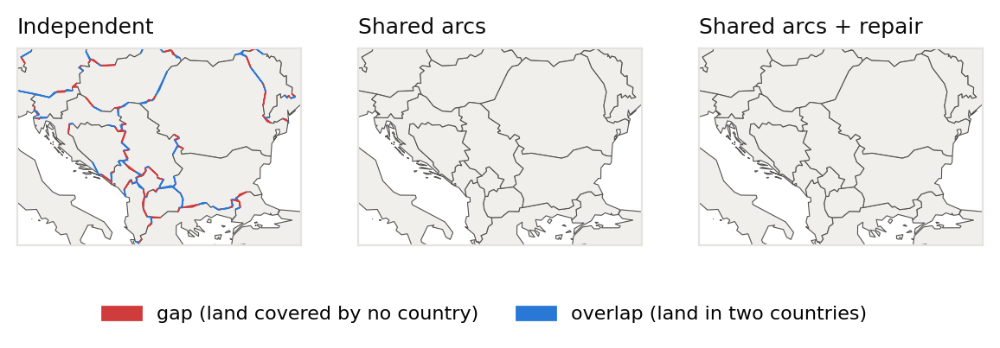

# geosimplify

**Topology-aware line simplification for web maps, with a reproducible benchmark on Natural Earth.**

[](https://github.com/sidewalkds-oss/geosimplify/actions/workflows/ci.yml)


Every web map simplifies its borders and coastlines before drawing them at small scales:
at zoom 2 a pixel spans about 39 km. Simplify each country on its own, though, and the
two copies of every shared border come out differently. Thin **gaps** open between
neighbours, **overlaps** appear, and boundaries **cross** each other.



`geosimplify` implements the three classic algorithms in three topology modes, and
measures what each one costs in shape error, validity and vector-tile bytes at real zoom
levels.

| | |
|---|---|
| **Algorithms** | radial distance, Douglas–Peucker, Visvalingam–Whyatt (DP and VW are tested to match textbook implementations exactly) |
| **Modes** | `independent` (per ring), `topology` (shared borders simplified once, as in TopoJSON), `safe` (shared arcs + Saalfeld-style repair of crossings and swallowed islands) |
| **Speed trick** | each vertex's significance is computed once; any zoom level is then a threshold |
| **Metrics** | displacement in screen pixels, area change, invalid geometries, segment crossings, sliver gaps/overlaps, Mapbox Vector Tile geometry bytes |

📄 **Paper:** [`paper/paper.tex`](paper/paper.tex), *Topology-Aware Line Simplification for
Web Maps: A Pixel-Tolerance Benchmark on Natural Earth*. CI builds the PDF on every push.

---

## Installation

```bash
git clone https://github.com/sidewalkds-oss/geosimplify.git
cd geosimplify
pip install -e ".[dev]"
```

Dependencies: `numpy`, `shapely>=2.0`.

## Quick start

```python
from geosimplify import Layer, Simplifier, layer_size

layer = Layer.from_geojson("data/ne_10m_admin_0_countries.geojson")   # projected to Web Mercator
simp = Simplifier(layer, method="dp", mode="safe")

features = simp.for_zoom(4)            # 1-pixel tolerance at zoom 4
print(simp.repairs, "vertices restored to remove crossings and swallowed islands")
print(layer_size(layer.kind, features, zoom=4))   # MVT geometry bytes
```

`for_zoom(z, pixels=1.0)` sets the tolerance to `pixels` screen pixels at zoom `z`;
`simplify(tol)` takes a tolerance in metres.

## Results

Natural Earth 1:10m countries (258 features, 548k vertices), simplified for **zoom 4** at a
1-pixel tolerance (9.8 km):

| Douglas–Peucker mode | Vertices kept | Invalid countries | Crossings | Sliver gaps | Overlap (px²) | Geometry KB |
|---|---|---|---|---|---|---|
| Independent | 9.2% | 67 | 2,452 | 857 | 786 | 135 |
| Shared arcs | 9.1% | 62 | 878 | 206 | 0.35 | 135 |
| **Shared arcs + repair** | **9.3%** | **0** | **0** | **0** | **0** | **137** |

- **Independent simplification breaks the coverage** at every zoom level, and radial distance
  is worst (6,101 gaps at zoom 4).
- **Shared arcs** remove overlaps but not crossings or swallowed islands.
- **Repair** removes the rest for about **2% more vertices** at zoom 4.
- **At equal vertex budgets** (10% of vertices), Douglas–Peucker's 95th-percentile displacement
  is **8.6 km**, against 34 km for radial distance and 69 km for Visvalingam–Whyatt.
  Visvalingam–Whyatt preserves **area** best (0.034% change vs 0.088%), but its displacement is
  unbounded: one vertex moved **53 km** even at a 100 m tolerance.
- With repair, Douglas–Peucker cuts MVT geometry payload to **6.9%** of the unsimplified layer at
  zoom 2 and **12.7%** at zoom 4.

### Against GEOS `CoverageSimplifier` (via `shapely.coverage_simplify`)

| Zoom 4 | Vertices | Hausdorff p95 | Hausdorff max | Invalid | Gaps | Geometry KB | Time |
|---|---|---|---|---|---|---|---|
| GEOS CoverageSimplifier | 66.8k | 4.95 px | 13.7 px | 0 | 0 | 160 | 3.6 s |
| Douglas–Peucker + repair | **50.8k** | **1.00 px** | **6.3 px** | 0 | 0 | **137** | 16.1 s |
| Visvalingam–Whyatt + repair | 67.6k | 4.89 px | 8.0 px | 0 | 0 | 163 | 15.0 s |

**Use GEOS when you need guaranteed-valid output fast.** It produced no invalid geometry, gaps
or dropped countries at any zoom, and ran 4–17× faster. **Use Douglas–Peucker + repair when
tile size and shape fidelity matter more.** At zooms 4–8 it gave 15–27% smaller geometry
payloads with one-pixel-bounded error, but left 1–2 invalid countries at some zooms, so run a
validity pass afterwards.

## Reproducing the paper

```bash
python experiments/download_data.py          # Natural Earth layers -> data/ (public domain)
python experiments/run_benchmark.py          # zoom + tolerance-sweep experiments (~25 min)
python experiments/run_coverage_baseline.py  # GEOS CoverageSimplifier comparison
python experiments/make_figures.py           # all figures and LaTeX tables
```

## Repository layout

```
src/geosimplify/
  algorithms.py   radial distance, DP and VW significance (threshold = simplification)
  topology.py     Web Mercator, GeoJSON reading, junctions, shared-arc graph
  core.py         Layer, Simplifier (independent / topology / safe), crossing & side checks
  metrics.py      displacement, area change, validity, coverage gaps/overlaps
  encoding.py     Mapbox Vector Tile geometry encoding (byte counts)
experiments/      benchmark, GEOS baseline, data download, figures/tables
results/          raw CSVs
paper/            LaTeX source, figures, tables
tests/            pytest suite
```

## Limitations

- Byte counts measure the MVT geometry command stream on the global grid. There is no tile
  clipping, and no feature or attribute overhead.
- Displacement is measured against the segment that replaced each vertex. That is an upper
  bound on the discrete Hausdorff distance.
- The implementation is pure Python. The repair mode takes 15–36 s per layer and zoom level.

## Citation

```bibtex
@misc{omar2026geosimplify,
  title  = {Topology-Aware Line Simplification for Web Maps: A Pixel-Tolerance Benchmark on Natural Earth},
  author = {Omar, Kaisi},
  year   = {2026},
  url    = {https://github.com/sidewalkds-oss/geosimplify}
}
```

Map data: Made with Natural Earth (public domain).

## License

MIT
